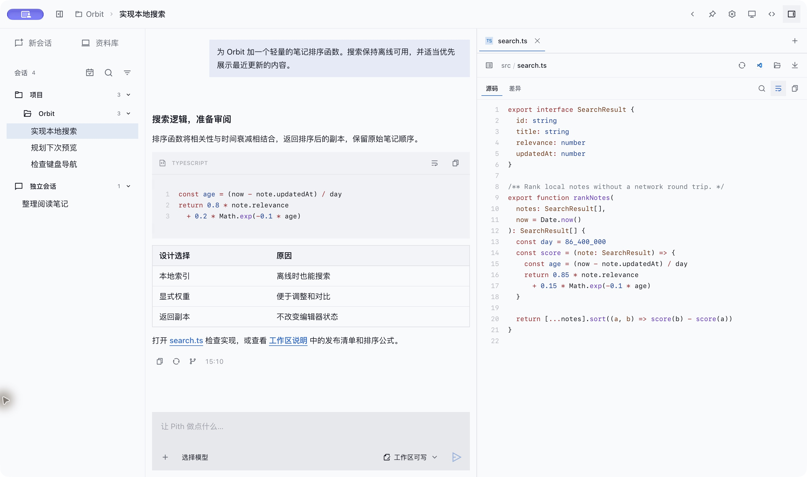
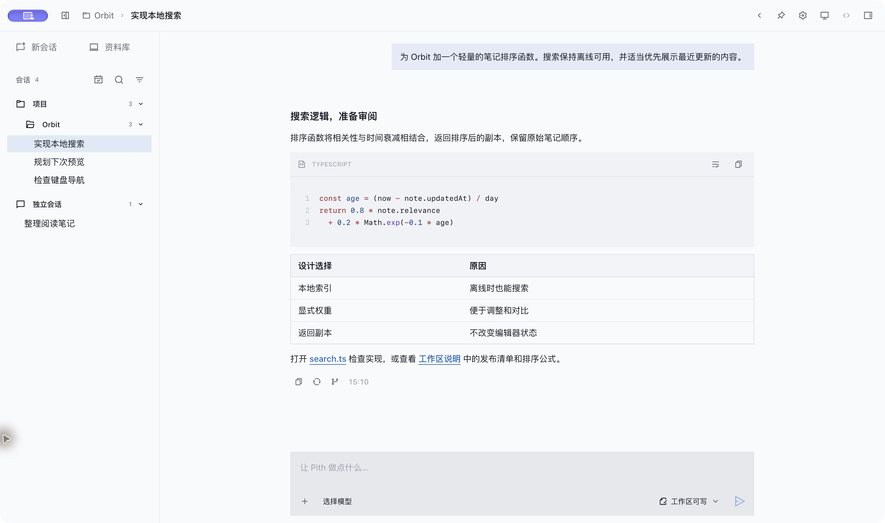
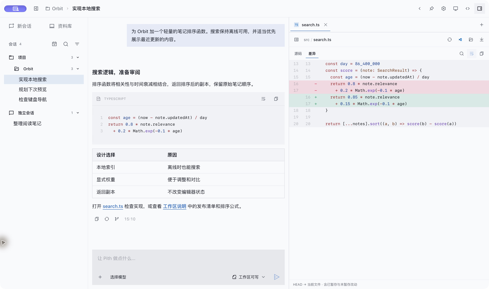

# Pith

English | [简体中文](README.zh-CN.md)

Pith is an independent, unofficial Electron desktop client for the Pi coding agent. It supports switching between rounded (squircle) and square UI styles in Settings → Appearance. It embeds the [Pi SDK](https://github.com/earendil-works/pi) (`@earendil-works/pi-coding-agent` 1.0.0) in the main process and builds its interface with beUI components vendored into the renderer, along with React and Tailwind CSS. The project is not affiliated with or endorsed by the Pi, beUI, DeepSeek, Z.AI, Pierre, Remix or Lucide projects.

**Status:** early development (`0.1.0`). This repository contains source and packaging configuration only; no installers, signed binaries or auto-update feed are published. Features and local file formats may change.

This first public snapshot consolidates earlier local development into a new commit dated at publication. It preserves third-party origins and notices; private checkpoints and uncommitted local work are not published.

## Screenshots

Current desktop development build (2026-10-29), captured in Chinese with the square UI style, an isolated Orbit demo project and staged conversations. This UI includes local changes ahead of the initial public source snapshot.

**Coding conversations with a side-by-side source preview**



| Projects and conversations | Git diff review |
| --- | --- |
|  |  |

## Features

Pith hosts Pi agent sessions and adds desktop surfaces around them. Model execution, session files and native MCP come from the Pi SDK; Pith owns the Electron host, the configuration and inspection UI, and the local tool boundaries described below.

- **Projects and conversations**: organize sessions by folder or start a projectless chat; search history, stream responses, inspect thinking and tools, steer, stop, continue, retry and fork.
- **Files and changes**: mention files, attach inputs and preview code, Markdown, math, notebooks, images and PDFs; review turn changes and diffs, and open files delivered by the agent.
- **Git workbench**: inspect repository changes and history, stage or unstage files, review discard confirmations, commit, switch branches and fetch/pull/push from the right panel.
- **Library**: collect user attachments, explicit deliveries, generated images and web sources by project; browse a stable photo wall, search records, hide unavailable content and keep local copies with a configurable directory and size limit. Downloads retain their source URL under Web.
- **Planning and Rewind**: review a submitted plan before explicitly approving execution; capture checkpoints before user messages, restore files, conversations or both, and undo or redo the latest restore.
- **Parallel work**: task lists, managed background commands, independent subagents and scheduled tasks. Inspect, guide or continue subagent work; schedules run while the app is running and the computer is awake.
- **Work panels**: interactive terminals, an embedded browser, a DAP debugger and picture in picture. Browser agent tools require enabling them in Settings and first-use consent.
- **MCP configuration**: edit MCP servers as a form or raw JSON, for both the global `~/.pi/agent/mcp.json` and a trusted project's `<cwd>/.pi/mcp.json`. Per-server connection state comes from the selected session's SDK runtime; servers and tools from other sessions are not mixed into it.
- **DAP debugging**: attach to or launch debug targets through the app's `debug` tool or a debug pane. LLDB (`lldb-dap`), Python (`debugpy`), Delve and an installed standalone js-debug are detected on the host; adapters use stdio or loopback TCP. Debugging stays off until enabled in Settings, and custom adapters can be registered in `~/.pi/agent/debug-adapters.json` or `.pi/debug.json`.
- **Models and extensions**: API key / OAuth sign-in, custom providers and models, thinking levels, MCP, Skills and Pi extensions; optional Jev judgments and workflow integration.
- **Run records**: inspect model requests, tool execution, context estimates, token usage and costs, and export execution records.
- **Appearance and language**: English, Simplified Chinese and Traditional Chinese; light / dark / system themes; accent colors; square / squircle interface styles.

## Run from source

Pith targets **Node.js 22.19 or later**. **Node 24 is recommended** for development and is what the test tooling and CI use. You also need npm, Git and a provider account or API key for model requests. If native dependencies cannot use prebuilt binaries, install your platform's C/C++ build tools.

```bash
git clone https://github.com/111-test-111/pith.git
cd pith
npm ci
npm run dev
```

Install scripts apply compatibility patches for the pinned Pi SDK, prepare the terminal's native helpers and generate file-type icons offline. Keep these scripts enabled; do not pass `--ignore-scripts`.

After launching, sign in or configure a model under **Settings → Providers**. Open a project folder or create a projectless chat, then select a model and permission mode in the composer. The right panel contains terminals, file previews and the execution trajectory.

## Local data, credentials and permissions

Pith reuses Pi's local configuration: sessions live in `~/.pi/agent/sessions/`, provider credentials in `~/.pi/agent/auth.json`, custom providers and models in `~/.pi/agent/models.json`, and MCP servers in `~/.pi/agent/mcp.json`. App preferences, browser data, indexes and Library copies live in `pi-app/` under the system application-data directory; the rename to Pith keeps that directory so existing data remains available.

Pith has no hosted backend or account service. Credentials are read and written locally, and model, OpenRouter image, MCP, Jev and web requests go directly from your machine to the services you configure, under their own terms and data policies.

Permission modes and the DSH-based file sandbox constrain the file effects of Pith's own `bash`, `edit` and `write` tools. They do not isolate network access, extensions, MCP servers, user terminals, the embedded browser or debug targets, and they are not a VM or container boundary. Confined calls fail closed when no enforcement runner is available; the Windows ACL runner is partial. Treat these modes as guardrails for cooperating agents, not as system-wide or network isolation.

## Architecture

| Directory | Purpose |
| --- | --- |
| `src/main/` | Electron lifecycle, Pi SDK sessions, tools, file/process services and background work |
| `src/preload/` | Typed IPC exposed through `window.pi` |
| `src/shared/` | Cross-process DTOs and shared protocols |
| `src/renderer/src/` | React/beUI interface, state, themes and English / Chinese messages |
| `scripts/` | Asset generation, SDK compatibility preparation, tests and checks |
| `resources/` | Brand SVGs, native packaging icons and vendored icon artwork |
| `docs/` | Architecture, feature boundaries and verification guides |

The main process owns the SDK and system capabilities; the renderer has no Node integration and accesses them only through the preload bridge. The main window runs with `contextIsolation` enabled and `nodeIntegration` disabled, but neither the renderer nor the SDK runs inside an OS sandbox. Feature boundaries are documented in [docs/README.md](docs/README.md).

Use beUI components and place app compositions in `components/app/`. Add every new user-visible string to the English, Simplified Chinese and Traditional Chinese dictionaries. See [AGENTS.md](AGENTS.md) for the full contribution rules.

UI glyphs use Remix Icon Line in the square interface and Hugeicons Stroke Rounded in the squircle interface, through one semantic adapter; the Remix Icon License v1.0 ships in `src/renderer/public/licenses/remix-icons.txt`. Shortcut keycaps use a vendored Lucide SVG subset with its original artwork and licenses in `src/renderer/public/lucide-keycaps/`. File-type icons use Pierre icons from `@pierre/trees` with local document/media additions and square/squircle adaptations. Original artwork and notices remain in `resources/bearded-icons/` (GPL-3.0) and `resources/pierre-icons/` (Apache-2.0); additions and overrides live in `resources/pierre-icons-extensions/`, and square adaptations in `resources/pierre-icons-square/`. Installation and builds prepare `src/renderer/public/file-icons/` offline, including licenses and addition notices; this generated directory stays outside version control. See [file icons](docs/file-icons.md) for exceptions and snapshot maintenance.

## Development

```bash
npm run dev          # Development mode with HMR
npm run typecheck    # Check main, preload and renderer types
npm run build        # Production build in out/
npm run preview      # Launch the built app
npm run clean        # Remove outputs, caches and generated assets; keep dependencies
```

Run `npm test` with Node 24 for the unified regression suite, or `npm run test:core` / `npm run test:ui` for a specific layer. The runner prepares once, isolates fixtures and writes JSON/JUnit reports and logs to `.test-results/`. Performance and real-provider tests are explicit separate groups. See the [testing guide](docs/testing.md) for selection, prerequisites, CI and coverage limits.

Pre-publication verification on macOS 27.2 / Node 26.12.1: typecheck and the production build passed; 64 of 65 core checks have passing evidence. `bash-tasks` still fails its queue-clear / completion-notification drain race assertion. That regression remains visible in the suite; it is not disabled or presented as a green full-suite result. Live provider accounts, packaged installers and other platforms were not certified by these checks.

After verification, `npm run clean` returns the checkout to an unbuilt state. The next development or build run regenerates the required file-type icons.

For Windows and Parallels guests, see the [Windows development guide](docs/windows-development.md).

## Packaging and platform limits

```bash
npm run pack         # Unpacked app for the current platform
npm run dist:mac     # DMG + ZIP
npm run dist:win     # NSIS installer
npm run dist:linux   # AppImage + deb
```

Packaging scripts build first and write artifacts to `dist/`. `electron-builder.yml` defines macOS, Windows and Linux targets, but a configured target is not a support guarantee. Build and validate native dependencies, terminals, the embedded browser and sandbox behavior on each platform you distribute. The CI workflow is configured to run the production build and core tests on macOS and Linux, UI tests on macOS, and typecheck/build/test-runner checks on Windows; it does not build or launch packaged applications. Signing and macOS notarization credentials belong to the distributor, and no update feed is configured.

GitHub Actions execution starts disabled for this initial source publication. The checked-in workflow describes intended coverage, not a claim of a successful hosted CI run; review credentials and distribution settings before enabling it.

`resources/pith.svg` is the native application icon master. `npm run icons` regenerates the tracked PNG, ICO and ICNS assets. `resources/pith-square.svg` provides the hard-edge tile variant. The new-chat header uses the background-free `resources/pith-mark.svg`, tinted with the live app accent in either interface style. Routine builds do not need to regenerate native icons.

## Documentation

| Document | Covers |
| --- | --- |
| [docs/README.md](docs/README.md) | Technical documentation index and verification commands |
| [AGENTS.md](AGENTS.md) | Repository ownership, UI rules and execution invariants |
| [docs/testing.md](docs/testing.md) | Test layers, prerequisites, reports and CI |
| [docs/windows-development.md](docs/windows-development.md) | Building in Windows and Parallels guests |
| [docs/native-mcp-codemode.md](docs/native-mcp-codemode.md) | Native MCP configuration, codemode and result contracts |
| [docs/debug-implementation.md](docs/debug-implementation.md) | Debug target ownership, adapters and stopped references |
| [docs/architecture/embedded-browser.md](docs/architecture/embedded-browser.md) | Browser hosting, tools and trust boundaries |
| [THIRD_PARTY_NOTICES.md](THIRD_PARTY_NOTICES.md) | In-tree third-party code, assets, copyrights and license locations |
| [LICENSES/](LICENSES/) | Complete license texts for ported upstream code |

## License and credits

Pith's first-party source is released under the [MIT License](LICENSE), Copyright © 2026 Pith contributors. Vendored and ported third-party code and assets keep their own licenses; the repository is not MIT as a whole. [THIRD_PARTY_NOTICES.md](THIRD_PARTY_NOTICES.md) records each in-tree source with its copyright, scope and license text.

- [Pi SDK](https://github.com/earendil-works/pi) — © 2025 Mario Zechner, MIT. Agent engine, session format and native MCP runtime.
- [beUI](https://github.com/starc007/ui-components) — © 2026 Saurabh Chauhan, MIT. Vendored `components/motion`, `components/agents` and `components/charts` with local patches.
- [pi-web](https://github.com/agegr/pi-web) — © 2026 agegr, MIT. Ported sandbox protocol, ask-user, scheduled-task, usage and browser modules.
- [DeepSeek Harness](https://github.com/deepseek-ai/deepseek-harness) — © 2026 DeepSeek, MIT. Ported local sandbox provider.
- [ZCode](https://github.com/zai-org/ZCode) — © 2026 Z.AI Co., Ltd., Apache-2.0. Adapted Git graph layout.
- [Pierre](https://pierre.co) file-type icons, `@pierre/trees` — © 2025 Pierre Computer Company, Apache-2.0, with the upstream headless-tree MIT notice.
- [Bearded Icons](https://github.com/BeardedBear/bearded-icons) — BeardedBear, GPL-3.0. Retained icon snapshot that installation still prepares; its full license text and notice stay in `resources/bearded-icons/`.
- [Lucide](https://github.com/lucide-icons/lucide) / [Feather](https://github.com/feathericons/feather) — ISC / MIT. Vendored shortcut keycap subset.
- [Remix Icon](https://github.com/Remix-Design/RemixIcon) — © 2017–2026 Remix Design, Remix Icon License v1.0 (not MIT), with its own restrictions.
- TeX Gyre DejaVu Math — GUST Font License plus the Bitstream/DejaVu notice; the bundled WOFF2 and license ship with the renderer.

Project names, logos and marks belong to their respective owners and are used only to describe origin. Third-party dependencies installed from npm keep their own licenses, including copyleft licenses such as MPL-2.0 and EPL-2.0 where applicable.
