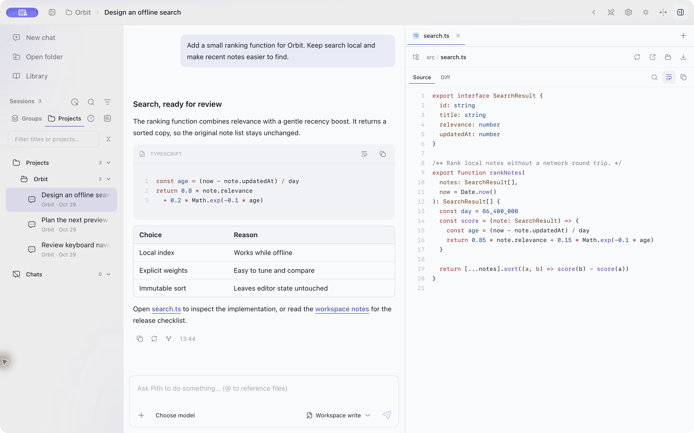
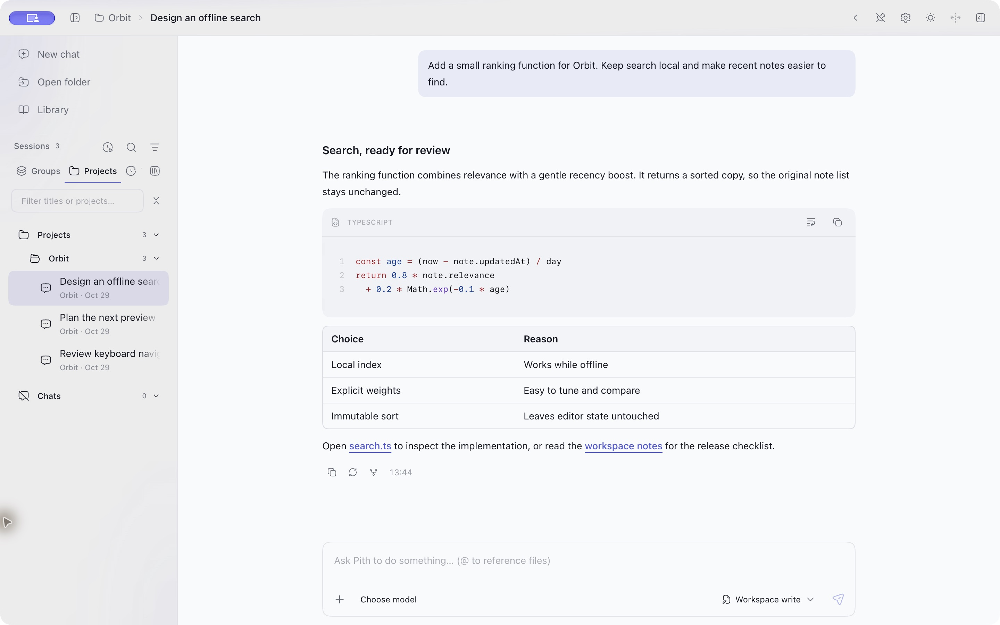
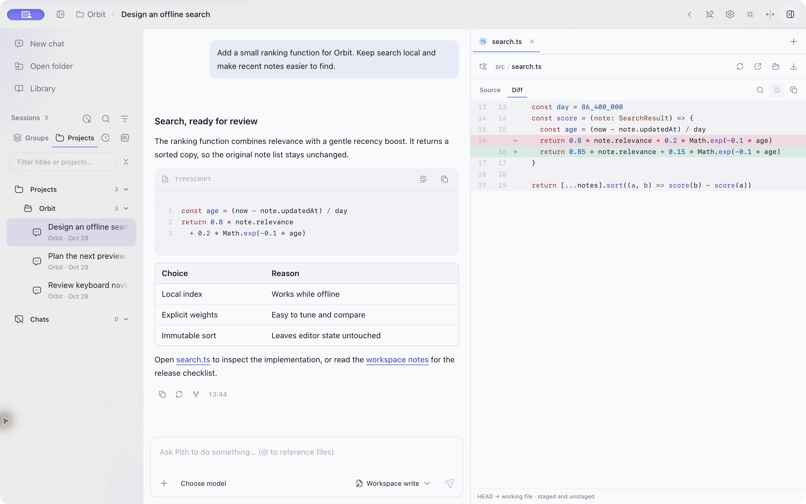

# Pith

[English](README.md) | 简体中文

Pith 是面向 Pi 编码代理（Pi coding agent）的独立、非官方 Electron 桌面客户端。它在主进程中内嵌 [Pi SDK](https://github.com/earendil-works/pi)（`@earendil-works/pi-coding-agent` 1.0.0），界面由复制进 renderer 的 beUI 组件、React 和 Tailwind CSS 构建。本项目与 Pi、beUI、DeepSeek、Z.AI、Pierre、Remix、Lucide 等上游项目没有隶属或背书关系。

**状态**：早期开发（`0.1.0`）。本仓库只包含源代码与打包配置，尚未发布安装包、签名二进制或自动更新通道；功能和本地文件格式仍可能变化。

首次公开快照将此前的本地开发整理为一个以实际公开时间创建的新提交，保留第三方来源和许可声明；不发布私人检查点或尚未提交的本地工作。

## 应用截图

实际启动 macOS 应用截取，使用独立的 Orbit 示例项目和预置演示会话。

**编码会话与并排源码预览**



| 项目与会话 | Git 差异审阅 |
| --- | --- |
|  |  |

## 功能

Pith 承载 Pi 的代理会话，并在其周围提供桌面工作界面。模型执行、会话文件和原生 MCP 来自 Pi SDK；Pith 负责 Electron 宿主、配置与检查界面，以及下文列出的本地工具边界。

- **项目与对话**：按文件夹管理会话，也可直接开始无项目对话；支持搜索历史、流式回复、思考与工具过程、追加指令、停止、继续、重试和分叉。
- **文件与变更**：引用文件、添加附件，预览代码、Markdown、数学公式、Notebook、图片和 PDF；查看本轮变更与 diff，接收代理交付的文件。
- **Git 工作台**：在右侧面板查看仓库变更与提交历史、暂存和撤销暂存、确认丢弃、提交、切换分支，以及获取、拉取和推送。
- **资料库**：按项目收集用户附件、主动交付、生成图片与网页来源；支持稳定的照片墙、搜索、隐藏不可达内容，并按可配置目录和容量上限保存本地副本。下载来源网址记录在网页区域。
- **计划与回退**：先提交计划，再明确批准执行；在用户消息前保存检查点，支持文件、对话或组合回退，以及最近一次回退的撤销和重做。
- **并行工作**：任务清单、受管理的后台命令、独立子代理及定时任务。可查看、引导或继续子代理的工作；定时任务在应用运行且电脑唤醒时执行。
- **工作面板**：交互式终端、内嵌浏览器、DAP 调试器和画中画。浏览器代理工具需在设置中启用并取得首次使用授权。
- **MCP 配置**：以表单或原始 JSON 编辑 MCP 服务器，同时支持全局 `~/.pi/agent/mcp.json` 和受信项目的 `<cwd>/.pi/mcp.json`。每个服务器的连接状态来自所选会话的 SDK 运行时；其他会话的服务器和工具不会混入该视图。
- **DAP 调试**：通过应用自带的 `debug` 工具或调试面板附加到目标或启动调试。应用会检测宿主上的 LLDB（`lldb-dap`）、Python（`debugpy`）、Delve 以及已安装的独立 js-debug；适配器使用 stdio 或本地回环 TCP。调试需在设置中启用；自定义适配器可写入 `~/.pi/agent/debug-adapters.json` 或 `.pi/debug.json`。
- **模型与扩展**：API Key / OAuth 登录，自定义模型与供应商，思考级别、MCP、Skills 和 Pi 扩展管理；可选的 Jev 判断与工作流集成。
- **运行记录**：查看模型请求、工具执行轨迹、上下文估算、Token 用量和费用，导出执行记录。
- **外观与语言**：英语、简体中文和繁体中文；浅色 / 深色 / 跟随系统主题；强调色；方角 / 连续圆角两种界面风格。

## 从源码运行

Pith 面向 **Node.js 22.19 或更高版本**；开发和测试推荐使用 **Node 24**，测试工具与 CI 也使用 Node 24。还需要 npm、Git，以及用于模型请求的供应商账号或 API Key。若原生依赖无法使用预编译包，需要安装对应平台的 C/C++ 编译工具链。

```bash
git clone https://github.com/111-test-111/pith.git
cd pith
npm ci
npm run dev
```

安装脚本会为固定版本的 Pi SDK 应用兼容补丁、准备终端原生辅助程序，并离线生成文件类型图标。请保持这些脚本启用，不要传入 `--ignore-scripts`。

启动后，在「设置 → 供应商」登录或配置模型；打开项目文件夹，或直接创建无项目对话，再从输入框选择模型和权限模式开始工作。终端、文件预览及执行轨迹位于右侧面板。

## 本地数据、凭据与权限

Pith 复用 Pi 的本地配置：会话位于 `~/.pi/agent/sessions/`，供应商凭据位于 `~/.pi/agent/auth.json`，自定义供应商与模型位于 `~/.pi/agent/models.json`，MCP 服务器位于 `~/.pi/agent/mcp.json`。应用偏好、浏览器数据、索引和资料库副本保存在系统应用数据目录中的 `pi-app/`；重命名为 Pith 后继续沿用该目录，因此既有数据仍然可用。

Pith 没有自建后端或账号服务。凭据只在本地读写；模型、OpenRouter 图片、MCP、Jev 和网页请求从你的机器直接发往你配置的服务，并受这些服务各自的条款与数据政策约束。

权限模式和基于 DSH 的文件沙箱仅约束 Pith 自带 `bash`、`edit`、`write` 工具的文件效果。它们不隔离网络访问、扩展、MCP 服务器、用户终端、内嵌浏览器或调试目标，也不是虚拟机或容器边界。缺少可用的限制执行器时，受限调用会按失败关闭；Windows ACL 执行器为部分实现。请把这些模式视为面向协作代理的护栏，而不是整机或网络隔离。

## 架构

| 目录 | 用途 |
| --- | --- |
| `src/main/` | Electron 生命周期、Pi SDK 会话、工具、文件/进程服务与后台工作 |
| `src/preload/` | 通过 `window.pi` 暴露的类型化 IPC |
| `src/shared/` | 跨进程 DTO 和公共协议 |
| `src/renderer/src/` | React/beUI 界面、状态、主题及英语/中文文本 |
| `scripts/` | 资源生成、SDK 兼容准备、测试与检查脚本 |
| `resources/` | 品牌 SVG、打包图标及随仓图标素材 |
| `docs/` | 架构、功能边界及验证说明 |

主进程负责 SDK 和系统能力；renderer 不启用 Node 集成，只能通过 preload 桥访问它们。主窗口启用了 `contextIsolation`、关闭了 `nodeIntegration`，但 renderer 与 SDK 都不在操作系统沙箱中运行。功能边界见 [docs/README.md](docs/README.md)。

界面组件使用 beUI，应用组合放在 `components/app/`；所有新增用户可见文字需同时加入英语、简体中文和繁体中文词典。完整约束见 [AGENTS.md](AGENTS.md)。

UI 图标通过统一语义适配层，在直角界面使用 Remix Icon Line，在超椭圆界面使用 Hugeicons Stroke Rounded；Remix Icon License v1.0 随应用保存在 `src/renderer/public/licenses/remix-icons.txt`。快捷键键帽使用少量随仓 Lucide SVG，原始图形和许可证保存在 `src/renderer/public/lucide-keycaps/`。文件类型图标使用来自 `@pierre/trees` 的 Pierre 图标，并包含本地文档/媒体补绘及直角、超椭圆适配。原始图形和声明保留在 `resources/bearded-icons/`（GPL-3.0）与 `resources/pierre-icons/`（Apache-2.0）；补绘和覆盖位于 `resources/pierre-icons-extensions/`，直角变体位于 `resources/pierre-icons-square/`。安装和构建会离线生成 `src/renderer/public/file-icons/`，并附带许可证与补绘声明；该生成目录不进入版本控制。例外与快照维护见[文件图标文档](docs/file-icons.md)。

## 开发

```bash
npm run dev          # 开发模式，支持 HMR
npm run typecheck    # 检查主进程、preload 和 renderer 类型
npm run build        # 生产构建，输出到 out/
npm run preview      # 启动已构建的应用
npm run clean        # 清理构建、打包、缓存及生成资源，保留依赖
```

使用 Node 24 运行 `npm test` 执行统一回归测试，或用 `npm run test:core` / `npm run test:ui` 选择测试层级。运行器统一准备构建、隔离测试环境，并将 JSON/JUnit 报告与日志写入 `.test-results/`。性能与真实模型测试需要单独选择。运行依赖、CI 与覆盖边界见[测试指南](docs/testing.md)。

公开前验证环境为 macOS 27.2／Node 26.12.1：类型检查和生产构建通过，65 项核心检查中的 64 项已有通过证据；`bash-tasks` 的清空队列／完成通知 drain 竞态断言仍未通过。该回归保留在检查中，不禁用、不改成假阳性，也不宣称全量通过。上述检查不认证真实服务商账号、打包安装或其他平台。

验证完成后可运行 `npm run clean` 回到未构建状态；下次开发或构建会自动重新生成所需的文件类型图标。

Windows 及 Parallels 虚拟机的环境准备和启动步骤见 [Windows 开发指南](docs/windows-development.md)。

## 打包与平台限制

```bash
npm run pack         # 当前平台的未安装应用
npm run dist:mac     # DMG + ZIP
npm run dist:win     # NSIS 安装包
npm run dist:linux   # AppImage + deb
```

打包脚本会先构建，产物写入 `dist/`。`electron-builder.yml` 定义了 macOS、Windows 和 Linux 目标，但配置了目标不等于获得支持保证。请在准备分发的每个平台上构建并验证原生依赖、终端、内嵌浏览器和沙箱行为。CI 工作流配置为在 macOS 与 Linux 上运行生产构建及核心测试，在 macOS 上运行 UI 测试，并在 Windows 上运行类型检查、构建与测试运行器检查；它不会构建或启动打包后的应用。代码签名和 macOS 公证凭据由发布者提供，当前未配置更新源。

首次公开时关闭仓库 GitHub Actions 执行。已检入的工作流描述预期覆盖，不代表托管 CI 已成功运行；启用前须审阅凭据及分发设置。

`resources/pith.svg` 是原生应用图标的母版，`npm run icons` 可重新生成已纳入版本控制的 PNG、ICO 和 ICNS。`resources/pith-square.svg` 提供方角底框版本。新会话页使用无背景的 `resources/pith-mark.svg`，在两种界面风格下都跟随应用强调色。日常构建无需重新生成原生图标。

## 文档

| 文档 | 内容 |
| --- | --- |
| [docs/README.md](docs/README.md) | 技术文档索引与验证命令 |
| [AGENTS.md](AGENTS.md) | 仓库归属、界面规则与执行不变量 |
| [docs/testing.md](docs/testing.md) | 测试层级、运行依赖、报告与 CI |
| [docs/windows-development.md](docs/windows-development.md) | Windows 及 Parallels 虚拟机中的构建 |
| [docs/native-mcp-codemode.md](docs/native-mcp-codemode.md) | 原生 MCP 配置、codemode 与结果契约 |
| [docs/debug-implementation.md](docs/debug-implementation.md) | 调试目标归属、适配器与停止引用 |
| [docs/architecture/embedded-browser.md](docs/architecture/embedded-browser.md) | 浏览器宿主、工具与信任边界 |
| [THIRD_PARTY_NOTICES.md](THIRD_PARTY_NOTICES.md) | 仓内第三方代码、素材、版权与许可证位置 |
| [LICENSES/](LICENSES/) | 移植上游代码的完整许可证文本 |

## 许可与致谢

Pith 自有源代码采用 [MIT License](LICENSE)，Copyright © 2026 Pith contributors。复制或移植的第三方代码与素材遵循各自许可证；本仓库整体不是 MIT。每个仓内来源的版权、范围与许可证文本记录在 [THIRD_PARTY_NOTICES.md](THIRD_PARTY_NOTICES.md)。

- [Pi SDK](https://github.com/earendil-works/pi) — © 2025 Mario Zechner，MIT。代理引擎、会话格式与原生 MCP 运行时。
- [beUI](https://github.com/starc007/ui-components) — © 2026 Saurabh Chauhan，MIT。复制进仓库的 `components/motion`、`components/agents`、`components/charts` 及本地补丁。
- [pi-web](https://github.com/agegr/pi-web) — © 2026 agegr，MIT。移植的沙箱协议、ask-user、定时任务、用量统计与浏览器模块。
- [DeepSeek Harness](https://github.com/deepseek-ai/deepseek-harness) — © 2026 DeepSeek，MIT。移植的本地沙箱提供程序。
- [ZCode](https://github.com/zai-org/ZCode) — © 2026 Z.AI Co., Ltd.，Apache-2.0。改绘的 Git 图布局。
- [Pierre](https://pierre.co) 文件类型图标（`@pierre/trees`）— © 2025 Pierre Computer Company，Apache-2.0，并保留上游 headless-tree 的 MIT 声明。
- [Bearded Icons](https://github.com/BeardedBear/bearded-icons) — BeardedBear，GPL-3.0。安装过程仍会准备的保留图标快照；完整许可证与声明保存在 `resources/bearded-icons/`。
- [Lucide](https://github.com/lucide-icons/lucide) / [Feather](https://github.com/feathericons/feather) — ISC / MIT。随仓快捷键键帽子集。
- [Remix Icon](https://github.com/Remix-Design/RemixIcon) — © 2017–2026 Remix Design，Remix Icon License v1.0（并非 MIT），带有其自身限制。
- TeX Gyre DejaVu Math — GUST Font License 及 Bitstream/DejaVu 声明；随 renderer 分发 WOFF2 与许可证。

项目名称、徽标与商标归各自所有者，仅用于说明来源。从 npm 安装的第三方依赖各自遵循其许可证，包括适用的 MPL-2.0、EPL-2.0 等 copyleft 许可。
